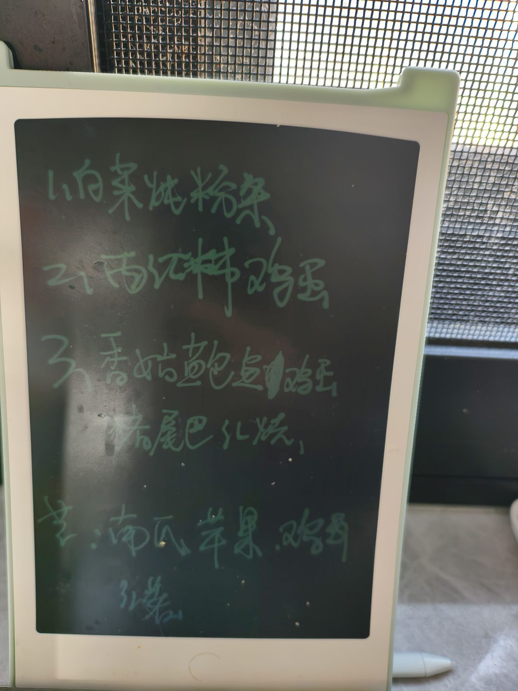
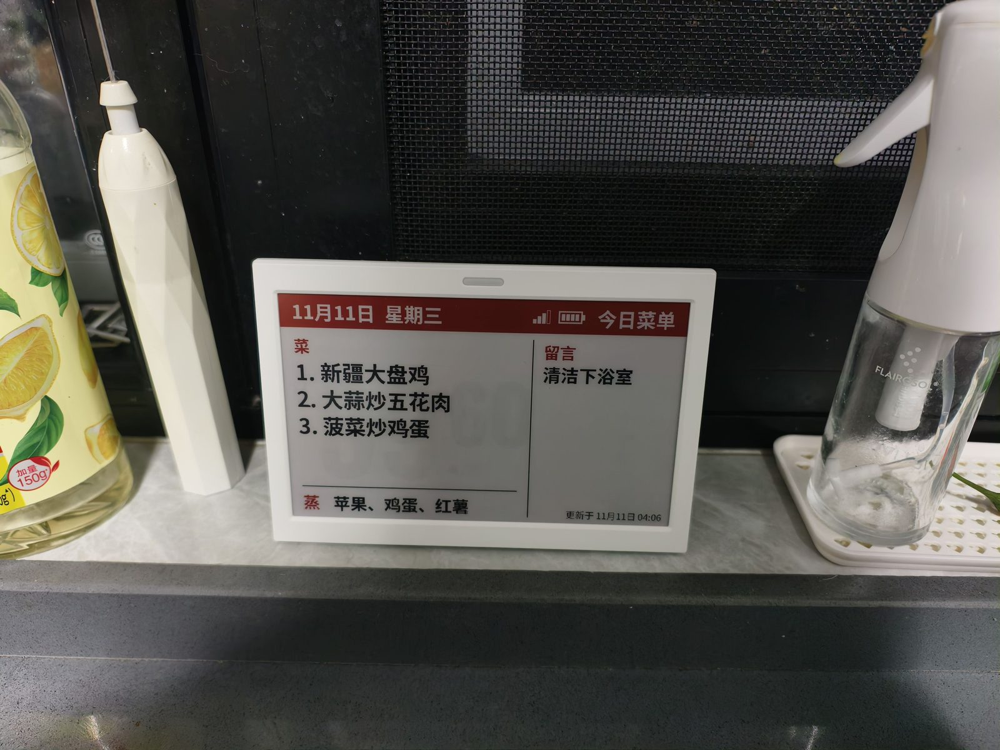
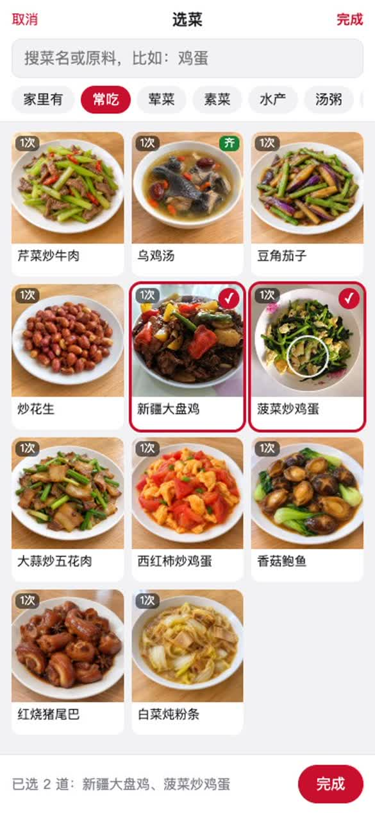
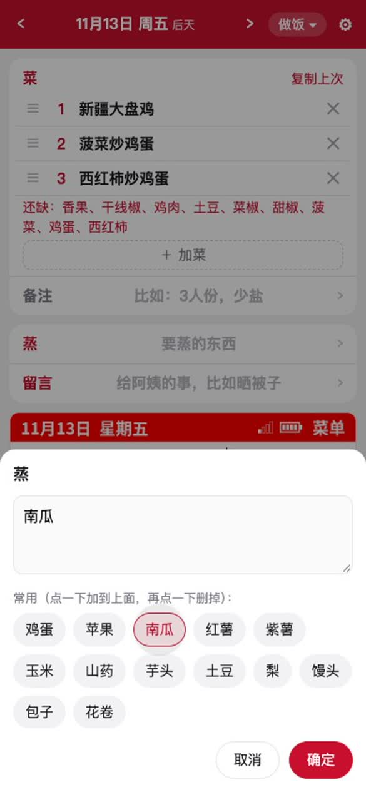
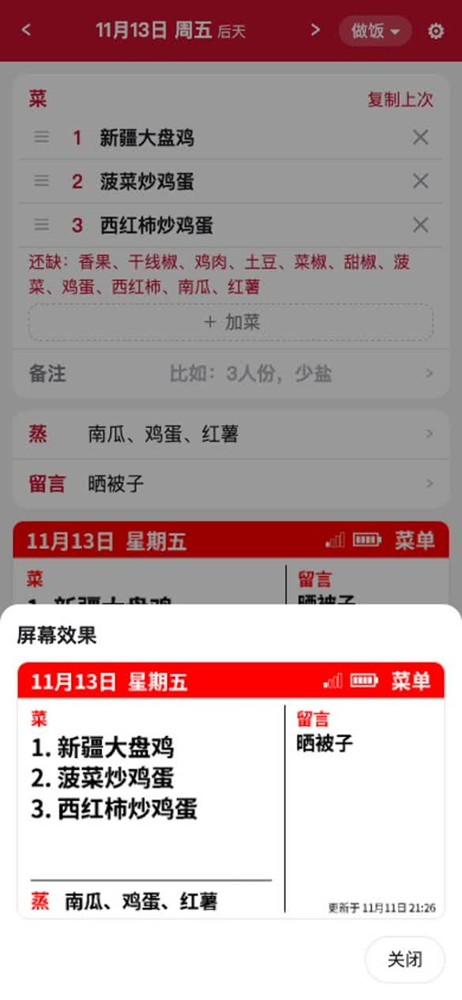

# 厨房墨水屏菜单

家里请了阿姨做饭，以前每天在手写板上写菜单，字丑、阿姨看不清、改一次擦一次。现在用 ESP32-C3 + 7.5 寸红黑白墨水屏做了块菜单屏放在厨房：**手机网页上点几下录好菜，屏幕到点自己醒来更新**，平时深度睡眠，很省电。

| 以前 | 现在 |
| --- | --- |
|  |  |

| 选菜 | 蒸的东西 | 屏幕预览 |
| --- | --- | --- |
|  |  |  |

## 能做什么

- **手机录菜单**：选菜页按常吃次数、家里有的食材排序，菜品库自带 [HowToCook](https://github.com/Anduin2017/HowToCook) 的几百道菜（带图和原料），也能自己加；要蒸的东西、给阿姨的留言、备注点常用项就加上；全部自动保存
- **屏幕自己更新**：屏幕按设定的时间醒来拉图，画面没变就不刷（三色屏刷一次十几秒，最耗电）。到了晚上自动切到阿姨下一次来的日子
- **阿姨的作息**：设置里选周几来、几点到几点走；每天还能单独设成「做饭 / 来了不做饭 / 不来」
- **周期家务**：擦楼梯、洗沙发套这类按天/周/月循环的，到期自动排进阿姨来做饭的日子，和留言一起上屏
- **食材和库存**：买过的东西可以从外部导入（买菜平台订单、手记、截图识别都走同一个接口），按「份」估家里还剩什么、快坏了什么，选菜时优先推荐原料齐的菜
- **通知和集成**：屏幕没按时醒、该充电了、明天的菜还没录，推到手机（ntfy / Bark）；所有事件都能发 webhook 给 Home Assistant 等自动化，也能从外部加留言（比如洗衣机洗完提醒晒衣服）
- **固件 WiFi 升级**：改完固件上传到服务器，屏幕下次醒来自己升级；新固件连不上服务器会自动回滚

## 怎么工作

```
手机网页 ──录菜单──▶ 服务端（FastAPI + SQLite，Docker 一键起）──渲染 800×480 黑红两层位图──▶ 墨水屏
                         │  ▲                                            （到点醒来 GET /api/frame，
                         │  └── 外部导入、HA 调用（加留言、洗衣机洗完）      拿图和下次睡多久）
                         └────▶ webhook / 通知（ntfy、Bark）
```

**所有逻辑都在服务端**：画什么、几点醒、刷不刷屏都由服务器决定，改版面、改醒来时间都不用动固件。

## 开始

### 让 AI 帮你装

屏幕接好线、用 USB 插到电脑上以后，把下面这段话发给电脑上的 AI 助手（豆包、WorkBuddy、Codex、Claude Code 这类能在本机执行命令的），它会按 [AGENTS.md](AGENTS.md) 部署服务端、刷固件，需要你按键时会告诉你：

> 帮我装 github.com/Anson2048/kitchen-menu 的厨房墨水屏。按仓库里 AGENTS.md 的步骤来：在这台电脑上部署服务端，再把 USB 上插着的屏幕刷好固件。需要我做什么就告诉我。

### 自己装

1. **做屏幕**：硬件清单、接线、组装见 [docs/hardware.md](docs/hardware.md)
2. **起服务端**：见 [docs/deploy.md](docs/deploy.md)，最快的是

   ```bash
   git clone <本仓库> && cd kitchen-menu
   cp .env.example .env
   docker compose up -d --build      # 打开 http://<这台机器的 IP>:8000
   ```

3. **刷固件、配网**：见 [firmware/README.md](firmware/README.md)。第一次用 USB 刷，之后都走 WiFi
4. **接通知和自动化**（可选）：见 [docs/integrations.md](docs/integrations.md)

接口说明见 [docs/api.md](docs/api.md)。

## 注意

- **服务没有登录**，只适合放在家里内网，或者在反向代理上加认证（见 [docs/deploy.md](docs/deploy.md)）
- 库存是估的，按「份」记账、按品类估保质期，不准就在网页上改

## 致谢

- 菜品库来自 [HowToCook](https://github.com/Anduin2017/HowToCook)（Unlicense）
- 墨水屏驱动用 [GxEPD2](https://github.com/ZinggJM/GxEPD2)
- 字体：Noto Sans CJK

## 许可

MIT，见 [LICENSE](LICENSE)。
