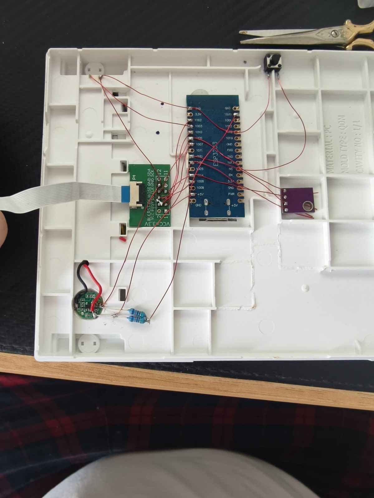
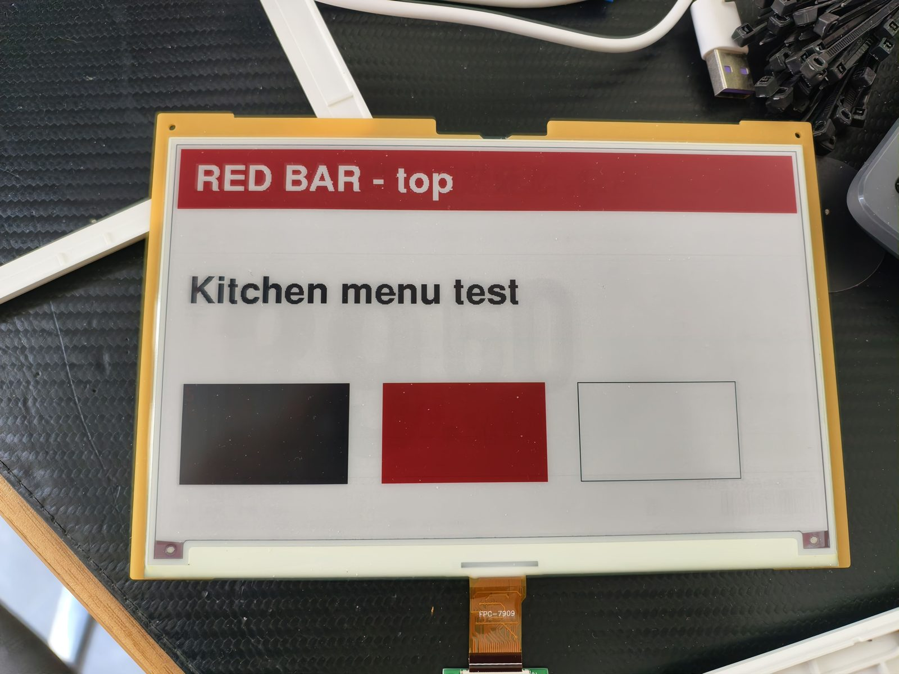
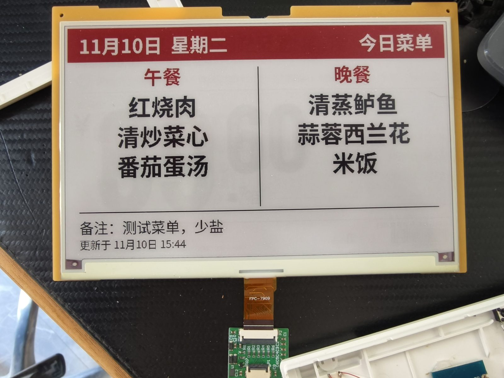

# 硬件：材料、接线、组装

我用的是闲鱼上一套 7.5 寸 DIY 台历的散件（2026-11，160 元左右）：外壳、屏幕、转接板、核心板、电池都有，自己飞线焊起来，再刷上这个项目的固件。没有现成套件的话，按下面的清单分开买也行。

## 材料

| 东西 | 型号 / 要求 | 说明 |
| --- | --- | --- |
| 主控 | **合宙 ESP32-C3 核心板**（CORE-ESP32-C3） | 原生 USB，不用串口芯片；Flash 4MB。别的 ESP32-C3 板子也行，引脚对应改固件里的 `PIN_*` |
| 墨水屏 | 7.5 寸 800×480 **红黑白三色**，驱动 IC **UC8179** | GxEPD2 里是 `GxEPD2_750c_Z08`（常见型号 GDEY075Z08）。换别的屏要改固件的驱动类 |
| 屏幕转接板 | 24pin FPC 转 SPI（引脚 BUSY、RST、DC、CS、SCK、MOSI、VCC、GND） | 图里绿色那块 |
| 温湿度（可选） | SHT40 / SHT4x 模块，I2C 地址 `0x44` | 图里紫色那块。不接也能用，只是网页上不显示温湿度 |
| 电池 | 锂电池 3.7V | 容量：待补 |
| 充电板 | 单节锂电充电板，带 Type-C 输入和升压/输出 | 图里左下角圆形那块；输出接核心板 +5V |
| 分压电阻 | 两个**等值**电阻 | 电池电压一分为二给 GPIO0 测电量（固件里 ×2）。阻值：待补（建议 100kΩ 级，越大越省电） |
| 按键 | 轻触按键 ×1 | 接核心板 EN（复位）：按一下叫醒屏幕、强制刷一次 |
| 外壳 | 7.5 寸相框/台历壳 | 能装下屏幕和电池就行 |
| 线 | 细漆包线或硅胶线 | 板内飞线 |

## 接线

| 屏幕转接板 | ESP32-C3 | 说明 |
| --- | --- | --- |
| BUSY | GPIO10 | |
| RST | GPIO8 | |
| DC | GPIO2 | |
| CS | GPIO7 | |
| SCK | GPIO4 | 和温湿度的 SCL 共用 |
| MOSI（SDA） | GPIO6 | 和温湿度的 SDA 共用 |
| VCC | 3.3V | |
| GND | GND | |

| 其他 | ESP32-C3 | 说明 |
| --- | --- | --- |
| SHT4x SDA / SCL | GPIO6 / GPIO4 | 和屏幕共线：固件先读温湿度、再用 SPI 刷屏，互不干扰 |
| SHT4x VCC / GND | 3.3V / GND | |
| 电池分压中点 | GPIO0 | 电池+ — 电阻 — GPIO0 — 电阻 — GND |
| 充电板输出 + / − | +5V / GND | |
| 按键 | EN 和 GND 之间 | 复位键 |

> 核心板背面的 BOOT 键（GPIO9）平时用不上；按住 BOOT 再按复位会进下载模式，救砖时用。

## 组装要点

- **飞线要固定**：漆包线细，外壳开合时容易扯断。我这块就断过一次充电板到核心板 +5V 的线，表现是拔掉 USB 后按键没反应、到点不醒、插充电器也没用。焊好后用热熔胶或胶带把线压住
- **外壳侧面的 Type-C 只能充电**（接的是充电板）。第一次刷机要把核心板自己的 Type-C 露出来或者拆壳接
- 拆前框从顶边撬卡扣，**小心屏幕排线**
- 先不装壳，接好线用 USB 刷固件，屏幕能正常显示了再装

## 第一次点亮

| 测试画面 | 第一版菜单 |
| --- | --- |
|  |  |

接好线后按 [firmware/README.md](../firmware/README.md) 刷机、配网，服务端起来以后屏幕就会显示当天的菜单。

## 耗电

屏幕大部分时间深度睡眠，每天按设置的时间醒几次（默认 3～4 次），每次联网 20～30 秒；画面没变就不刷屏。网页「设置 › 屏幕」里能看到电量和按放电速度估的续航。电量格数的电压阈值（`app.py` 的 `BAT_STEPS`）是按常见锂电池定的，可以用一个放电周期后自己校准。
